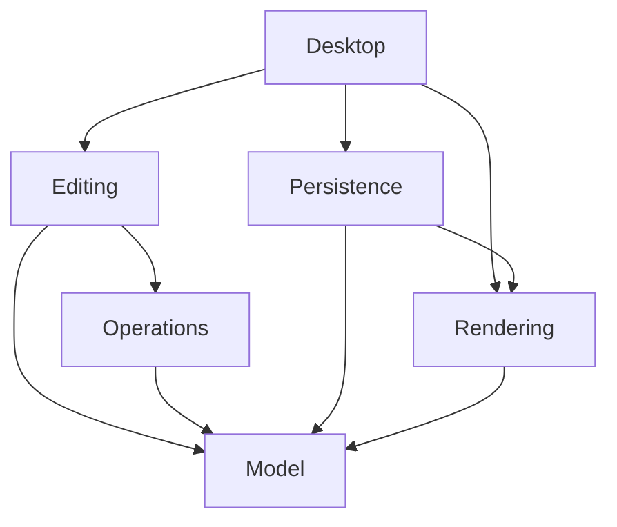

# Zyri target architecture

Implementation update: see [implementation status](implementation-status.md) for delivered behavior and departures from this design. The original planning text below is retained as context.

Status: proposed design, October 22, 2026. The current prototype does not implement these contracts. See the [audit](code-audit.md) for current behavior and the [implementation plan](implementation-plan.md) for delivery order.

## Product and technology decisions

Keep C++20 and Qt Widgets. Qt supplies desktop menus, actions, docking, file dialogs, text layout, and image primitives; replacing all of that would distract from editor correctness. A polished interface requires consistent interaction and visual design, not an automatic switch to QML.

Keep the document and raster engine independent of a window or GPU. Use Qt Core/Gui value types pragmatically; avoid a second string, path, or image abstraction merely to eliminate Qt. Persistent data need not inherit QObject. QObject-based sessions can publish change notifications.

Use CPU-owned sparse raster tiles as authoritative pixels. Start with a deterministic CPU renderer and QWidget/QPainter viewport. Treat acceleration as presentation first, with GPU compositing introduced only after reference-image parity and profiling.

For acceleration, evaluate a QRhiWidget adapter using Metal on macOS. Apple [deprecated OpenGL in macOS 10.14](https://developer.apple.com/library/archive/documentation/GraphicsImaging/Conceptual/OpenGL-MacProgGuide/opengl_intro/opengl_intro.html). [QRhiWidget](https://doc.qt.io/qt-6/qrhiwidget.html) supports multiple graphics backends and has existed since Qt 6.7, but its underlying QRhi classes have limited compatibility guarantees and require private GUI headers. Pin the Qt minor version, isolate this dependency, and keep a software fallback. The locally verified Qt 6.10.2 is an initial reproducible baseline, not a claim about the best release version.

Do not add Skia, a second UI framework, or separate native GPU engines until a measured deficiency justifies their build and maintenance costs.

## Modules and dependency direction

| Module | Responsibilities | Allowed project dependencies |
| --- | --- | --- |
| Model | Document metadata, layers, objects, immutable tiles, snapshots, change descriptions | None |
| Raster and vector operations | Brush sampling/stamps, fills, selection math, geometry, transforms | Model |
| Rendering | CPU compositing, vector/text rasterization, region and export rendering | Model |
| Editing | Transactions, history, active layer, selections, tool state machines | Model, operations |
| Persistence | Project format, image codecs, recovery generations | Model, rendering |
| Desktop | Sessions, widgets, actions, panels, input adapter, viewport, job scheduling | Editing, persistence, rendering |
| Platform adapters | Display integration, platform file access, packaging integration | Narrow desktop-facing interfaces |

These are dependency boundaries, not a requirement to immediately create seven libraries. Begin with model/operations, editing, persistence, rendering, and desktop targets as needed. Keep all model types below rendering and editing. No include from Model into Engine, no call from a brush algorithm into a history compressor, and no QWidget in a document header.

## Document ownership and identity

One DocumentSession owns a document, its history, active layer, selection, view state, pending jobs, and file association. The desktop owns sessions. Views reference sessions through lifetime-safe handles; background jobs retain immutable snapshots and cancellation tokens, never raw widget/controller pointers.

A document contains dimensions in document pixels, PPI for physical export sizing, working color space, format version, and an ordered stack of layers. A layer has a persistent UUID, name, visibility, lock, opacity, blend mode, and typed content. UUIDs must survive save/load and undo; duplication creates new identities.

Use two initial layer types:

- Raster layer: sparse tile store. Paint modifies only raster layers.
- Vector layer: ordered scene objects. Shapes, paths, and text are object types in that scene.

A separate top-level TextLayer hierarchy is unnecessary. A text object contains editable text and style runs, its frame, transform, and font descriptors. Use Qt text layout through an adapter, not HTML as the canonical format. Persist path commands and style values explicitly rather than opaque QPainterPath memory.

Start with a flat layer stack and ordered scene objects. Add object transforms and a finite shape/path vocabulary before nested groups, clipping stacks, adjustment nodes, or a general scene graph. Store semantic rectangle/ellipse primitives so size and corner properties remain editable.

Treat canvas transparency as the default. A chosen background color creates an ordinary raster background layer; checkerboard color belongs to the view and never appears in export.

## Editing transactions

Every persistent edit goes through the session's editing service.

1. Begin a transaction against a valid document state and target IDs.
2. Validate dimensions, lock state, selection policy, and available resource budget.
3. Capture immutable before-references; allocate writable buffers only for touched tiles or objects.
4. Expose provisional results to rendering while the transaction is active.
5. Commit one atomic change set, or cancel and discard provisional results.
6. On commit, publish history, state identity, render revisions, and one structured change notification.

The committed document remains immutable to background readers. Save/autosave snapshots contain completed transactions only. A save during a stroke waits for the stroke's commit or uses an explicitly completed earlier state; it must not mix provisional and committed tiles.

Notifications identify changed layers, old/new object bounds, tile keys, structural changes, and metadata. Engines do not reach into texture caches. The UI, thumbnails, composite cache, and title/dirty indicator all consume the same changes.

Use a monotonically increasing mutation revision for stale-job detection and cache invalidation. Separately track a content-state ID in history for dirty/clean comparison; undo can return to a saved content state while mutation revisions continue increasing.

## Input and tools

Normalize Qt events to document-space samples containing position, timestamp, pressure, tilt when available, device identity, buttons, and modifiers. Mouse pressure defaults to one. Clamp values and reject non-finite coordinates. Gesture routing and device-pixel conversion belong in the input/view adapter.

A tool is a small state machine with idle, dragging, commit, and cancel behavior. Handle focus loss, document close, tool switch, pointer leaving the canvas, Escape, and duplicate synthesized mouse events. Each drag is one transaction. Space temporarily pans; the application defines whether an active stroke commits or cancels before a tool switch.

Use distance-based brush resampling with accumulated spacing across event boundaries, pressure interpolation, and a final endpoint policy. Distinguish per-dab flow from overall stroke opacity so slow input does not accidentally redefine the chosen opacity. Start with round hard/soft brushes, pencil, and eraser sharing the stroke pipeline. Cache brush coverage masks where measurement shows benefit.

Qt documents [tabletEvent delivery and synthesized mouse behavior](https://doc.qt.io/qt-6/qtabletevent.html). Use the documented API first; retain platform-specific workarounds only when reproduced against the pinned Qt version. Tablet hardware validation is a later release activity, not part of this code-only review.

## Raster and vector rendering

The CPU renderer accepts an immutable snapshot, output region, output scale, and color settings. It produces pixels without a widget or GPU. Export, thumbnails, previews, and software presentation use this path.

Raster layers sample document pixels. Vector objects and text are rasterized into the requested target resolution before compositing in correct layer order. Normal, Multiply, Screen, and Overlay must share defined alpha and color-space semantics across implementations. Unsupported blend modes must not silently render as Normal.

The initial editable canvas uses a document-pixel preview: vector objects remain editable, but their preview follows the document raster grid. A later vector-quality preview may rerasterize at view resolution. It must be explicitly labeled and tested so zoom does not silently alter the document's pixel appearance or export semantics.

Use old and new object bounds for invalidation, expanded for stroke width and sampling support. Add spatial indexing when profiling warrants it. A vector raster cache is derived data and never replaces the editable scene.

The accelerated adapter initially uploads already-composited CPU tiles. This keeps pixels identical while validating GPU lifetime, texture uploads, culling, DPI, and fallback. Only move per-layer composition to GPU when profiling proves CPU composition is the limiting factor.

## Pixel and color policy

The first release uses 8-bit RGBA premultiplied pixels in an sRGB document working space. Define the byte layout and color encoding explicitly; never infer them from a uint32_t's host endianness. Qt image conversions stay inside adapters. Fully transparent pixels use zero RGB.

For v1, compositing and blend modes operate in encoded sRGB for familiar conventional 8-bit painting behavior. This is a deliberate tradeoff, not physically linear light. A later linear-light or higher-bit-depth mode requires an explicit document setting, new fixtures, and format handling; never change old document appearance silently.

Import tagged RGB images through a profile conversion to working sRGB; assume sRGB for untagged RGB images and disclose that assumption in import information. Unsupported or invalid profiles produce a clear result instead of silently pretending the image was converted. Preserve alpha explicitly. Higher-depth or out-of-gamut imports need an explicit conversion policy.

Export PNG/JPEG with appropriate sRGB metadata. JPEG uses a user-chosen matte because it cannot retain transparency. Display conversion is separate from document conversion. Validate SDR sRGB presentation on the selected backend, and avoid applying both an application display transform and an equivalent compositor transform. Do not claim arbitrary monitor-profile or wide-gamut editing support until verified.

Use [QColorSpace](https://doc.qt.io/qt-6/qcolorspace.html) and [QImage color transforms](https://doc.qt.io/qt-6/qimage.html) as the first implementation candidate. Test tagged PNG/JPEG, transparent colored edges, and a profile conversion fixture. Retain or reintroduce lcms2 only for a demonstrated requirement that the Qt path cannot satisfy.

## Worker jobs and responsiveness

Initially, one owner thread serializes document commits. Bounded brush work can run on that thread until measurements justify a dedicated editing queue. Expensive fills, transforms, render jobs, decoding, compression, and saving run on bounded worker pools using snapshots.

Each result carries document ID, base revision, and cancellation information. A stale fill/transform must not overwrite a newer edit: discard it or ask the editing service to recompute. Closing a session cancels jobs and disconnects their delivery safely.

Limit outstanding work, prioritize interactive drawing, coalesce superseded preview jobs, and budget temporary buffers before allocation. Moving a whole operation to QtConcurrent does not by itself solve races, memory pressure, or cancellation.

## Native format and file safety

Use a versioned ZIP container for portable editable projects. Select libzip as the initial archive implementation candidate; its [official documentation](https://libzip.org/) describes ZIP/ZIP64 read/write support. Pin and review the dependency before integration. Do not write a custom ZIP implementation or depend on Qt's private ZIP classes.

Proposed contents:

- Manifest: schema version, dimensions, PPI, working profile, ordered layers and persistent IDs.
- Tile entries: canonical RGBA8 premultiplied bytes, explicit dimensions/format, no native memory padding; archive compression only, avoiding redundant double compression.
- Vector entries: versioned geometry, transforms, styles, object ordering, and text records.
- Embedded profile and optional thumbnail; neither substitutes for editable content.

Opening validates declared sizes, entry count, expansion limits, paths, enum values, finite transforms, and UUID uniqueness before allocating document storage. Read entries directly rather than extracting arbitrary archive paths. Unknown required features cause an explicit unsupported-version result. Maintain fixture files and migration tests once the schema ships.

For saves, create a consistent snapshot and build the complete archive in a unique temporary file. Initially stream that completed file into QSaveFile at the destination, then commit; this costs extra I/O but avoids holding the archive in RAM or coupling libzip to a custom write callback. Keep direct-write fallback disabled. Clean temporary files on all exits.

[QSaveFile](https://doc.qt.io/qt-6/qsavefile.html) provides temporary-file/commit behavior and reports write failures. Still test destination filesystem behavior, disk-full handling, permissions, cancellation, and failed replacement. Do not promise survival of every filesystem or power-loss failure.

The saved-state marker records the snapshot that was saved, not whatever state happens to be current when the asynchronous job finishes. Serialize writes to the same destination so older saves cannot replace newer ones.

## Recovery and resource limits

Introduce local recovery as soon as editable projects work. Write a new recovery generation from a committed snapshot, verify completion, then rotate older generations. Keep at least the previous valid generation. Recovery never overwrites the user's original document automatically.

Use per-document/session identifiers, a local registry, and explicit handling of concurrent app instances. Offer recovered work as a separate unsaved document, with timestamp and original location. Recovery failures remain visible, and a failed new generation does not delete the previous one.

Budget document pixels, active edits, history, composite caches, GPU textures, and worker scratch independently. The initial release can impose tested document limits rather than implement a general virtual-memory system. History spill and document tile paging are separate projects. See [tile storage](tile-system.md) and [history](undo-design.md).

## Desktop and platform boundaries

Build a usable layout early: native menu bar, left tool strip, central canvas, right layers/color/properties panels, contextual tool options, and status/zoom. Centralize actions, shortcut enablement, and active-session routing. Use per-document tabs after one session's lifecycle is correct.

Prefer direct signed macOS distribution for the initial release; sandboxed distribution is a separate product decision. Do not couple the document engine to security-scoped bookmarks. If sandboxing is selected, preserve the resolved security-scoped URL in a balanced RAII access object rather than reconstructing access from a path string.

Use Objective-C++ only for narrow platform needs. Keep release packaging, dependency deployment, signing, and notarization separate from normal builds. App behavior remains local-only.
